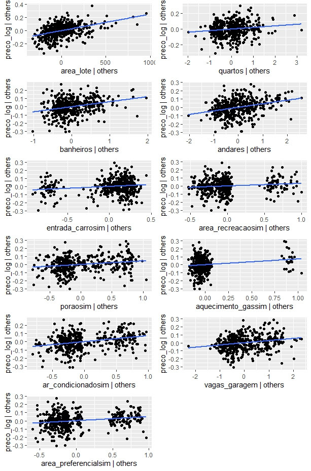
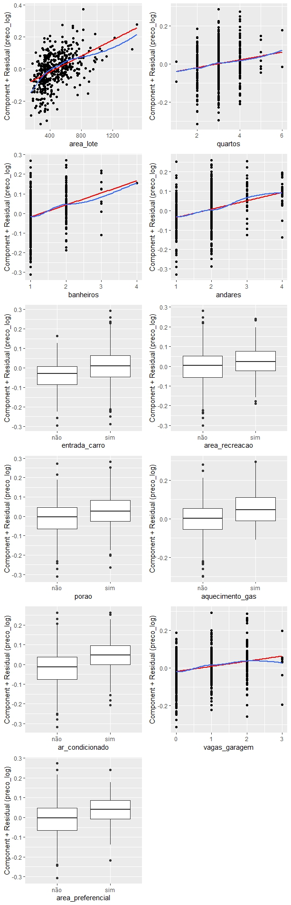

```{r setup, include = FALSE}
#Bibliotecas
library(reglin)
library(car)

# Carrega os dados preparados e os modelos ajustados
load("data/dados_preparados.RData")
load("data/parte2_modelos_lineares.RData")

# Define os modelos 
modelo <- modelo_stepwise
modelo_original <- update(modelo, preco ~ .)
modelo_log <- modelo
```

``` markdown
# Parte 4: Diagnóstico e Adequação de Resíduos

Essa parte tem como objetivo analisar se o modelo ajustado da regressão múltipla atende as suposições de linearidade e independência dos erros.

## Parte 4.1: Tipos de Resíduos
Para avaliar a adequação do modelo foram calculados três tipos de resíduos: ordinários, estudentizados internamente e estudentizados externamente.

### Resíduos Ordinários
Os resíduos ordinários ($e_i$) correspondem à diferença entre os valores observados da variável resposta ($y_i$) e os valores ajustados pelo modelo ($\hat{y}_i$): 
$$e_i = y_i - \hat{y}_i, \quad i = 1, \dots, n$$
```

```{r}
residuos <- residuals(modelo)
summary(residuos)
```

``` markdown
Os resultados sugerem que os resíduos ordinários estão centralizados em torno de zero, conforme esperado.

### Resíduos Estudentizados Internamente
Para corrigir a variação na variância dos resíduos ordinários causada pela alavancagem $h_{ii}$, cada resíduo é dividido pelo seu desvio padrão estimado utilizando o Quadrado Médio dos Resíduos (QMRes) de todo o modelo ajustado:
$$r_i = \frac{e_i}{\sqrt{\text{QMRes}(1 - h_{ii})}}$$
```

```{r}
residuos_ei <- rstandard(modelo)
summary(residuos_ei)
```

``` markdown
Os resíduos estudentizados internamente apresentaram valores extremos próximos a -3 e 3. Considerando que valores absolutos superiores a 3 podem indicar observações com comportamento atípico, esses resultados apontam a existência de possíveis casos que merecem atenção.

### Resíduos Estudentizados Externamente
Para evitar que a própria $i$-ésima observação atípica distorça a estimativa da variância residual ($\sigma^2$), calcula-se a variância residual $S_{(i)}^2$ retirando a $i$-ésima observação do ajuste do modelo. O resíduo estudentizado externamente é dado por:
$$t_i = \frac{e_i}{S_{(i)}\sqrt{1 - h_{ii}}} = r_i \left( \frac{n - p - 1}{n - p - r_i^2} \right)^{1/2}$$
```

```{r}
residuos_ee <- rstudent(modelo)
summary(residuos_ee)
```

``` markdown
Os resíduos estudentizados externamente apresentaram amplitude semelhante aos internamente estudentizados, indicando a existência de possíveis observações atípicas, cuja influência sobre o ajuste do modelo deverá ser investigada por meio de análises complementares de diagnósticos de influência.

## Parte 4.2: Análise dos Resíduos
Para complementar a análise descritiva dos resíduos, foram utilizados os gráficos diagnósticos da função ggresiduals(), disponibilizada pelo pacote reglin, e os testes estatístico disponibilizados pela função testResiduals(). Essa análise tem como objetivo verificar se os pressupostos do modelo de regressão linear múltipla são razoavelmente atendidos, especialmente em relação à normalidade dos resíduos, à homocedasticidade e à presença de observações atípicas.

### Análise dos Gráficos Diagnósticos
```

```{r}
ggresiduals(modelo)
```

``` markdown
A Figura 1 apresenta os gráficos diagnósticos do modelo ajustado com a variável resposta transformada em logaritmo (preco_log).

No gráfico Resíduos versus Valores Ajustados, os resíduos apresentam distribuição aleatória em torno de zero, indicando que a relação entre as variáveis explicativas e a variável resposta está adequadamente representada pelo modelo.

No gráfico Normal Q-Q, os resíduos apresentaram pequenos desvios nas extremidades, sugerindo possíveis desvios de normalidade.

No gráfico Scale-Location, os resíduos apresentam dispersão aproxidamente constante ao longo dos valores ajustados, com alguns poucos outliers, indicando homocedasticidade.

Por fim, o gráfico de ResÍduos vs Alavancagem auxilia na identificação de observações que podem exercer influência sobre o ajuste do modelo. O gráfico sugere a existência de observações que podem merecer investigação adicional, cuja análise detalhada de influência é desenvolvida em outra etapa do projeto.

### Testes Estatísticos dos Resíduos
Além da avaliação gráfica, foram realizados testes estatísticos para verificar formalmente alguns pressupostos do modelo. Os resultados obtidos para o modelo com a variável resposta transformada em logaritmo são apresentados a seguir.
```

```{r}
testResiduals(modelo)
```

``` markdown
#### Normalidade dos resíduos - Teste de Shapiro-Wilk
O teste de Shapiro-Wilk apresentou estatística W = 0,9909 e p-valor = 0,008944. Considerando o nível de significância de 5%, rejeita-se a hipótese nula de normalidade, indicando evidências estatísticas de que os resíduos não seguem uma distribuição normal, o que também foi indicado pelo gráfico. 

#### Homocedasticidade - Teste de variância não constante
O teste de variância não constante apresentou estatística qui-quadrado = 0,677467 e p-valor = 0,41046. Como o p-valor é superior a 0,05, não se rejeita a hipótese nula de variância constante dos erros. Dessa forma, não foram encontradas evidências estatísticas de heterocedasticidade.

#### Independência dos resíduos - Teste de Durbin-Watson
O teste de Durbin-Watson apresentou estatística DW = 1,1923 e valor-p aproximadamente igual a zero. Esse resultado indica evidências de autocorrelação positiva entre os resíduos, sugerindo possível violação do pressuposto de independência dos erros.

É importante notar que o teste de Durbin-Watson é utilizado para séries temporais, sendo sua aplicação em dados com "organização" transversal limitada, uma vez que o resultado pode ser influenciado pela ordem das observações. Para verificar essa questão, foram realizados 1000 embaralhamentos aleatórios da base de dados, nos quais a estatística DW apresentou média de 1,9986, aproximando-se de 2. Esse resultado sugere que a autocorrelação identificada na ordem original pode estar relacionada à disposição dos dados, não sendo possível concluir, apenas com esse teste, pela existência de dependência entre os erros do modelo.

#### Identificação de observações atípicas - Teste de Bonferroni
Por fim, o teste de Bonferroni não identificou resíduos estudentizados significativamente discrepantes, considerando o nível de significância de 5%.

### Conclusões
O teste de variância não constante não apontou evidências de heterocedasticidade, e o teste de Bonferroni não identificou outliers significativos. O resultado do teste de Durbin-Watson merece atenção, mas sua interpretação é limitada pela natureza transversal dos dados e pela ordem das observações.

Assim, considerando os diagnósticos realizados, o modelo transformado apresenta adequação razoável aos pressupostos avaliados, com ressalva quanto à normalidade dos resíduos e à autocorrelação indicada pelo teste de Durbin-Watson.

## Parte 4.3: Gráficos de Regressão Parcial
Foram utilizados os gráficos Added-variable plots (avPlots) para avaliar a contribuição parcial das variáveis explicativas, controlando os efeitos das demais variáveis do modelo e os gráficos Component-plus-residual plots (crPlots) com o objetivo de avaliar a adequação da forma funcional linear. 

### Gráficos avPlots
```



``` markdown
Todos os gráficos apresentados acima exibem uma tendência positiva, embora com diferentes graus de inclinação, indicando que as variáveis explicativas apresentam associação parcial positiva com o preço.

É interessante notar que as variáveis categóricas binárias assumem originalmente os valores 0 e 1, correspondentes a "não" e "sim", respectivamente. Entretanto, nos gráficos avPlots, os valores representados não se restringem necessariamente a esses dois pontos, uma vez que refletem os resíduos das variáveis após o controle pelas demais variáveis explicativas do modelo.

### Gráficos crPlots
```



``` markdown
Na imagem apresentada acima, a grande maioria dos gráficos das variáveis contínuas apresenta uma proximidade satisfatória entre a linha vermelha de ajuste linear e a linha azul suavizada, indicando adequação da especificação linear.A única exceção ocorre na variável area_lote, cuja curva azul exibe uma curvatura acentuada em relação à reta vermelha, evidenciando que a relação não é estritamente linear e justificando a necessidade de correções por meio de termos polinomiais ou splines.

#### Adequação de area_lote
Para "corrigir" a não-linearidade apresentada no gráfico de resíduos parciais da variável explicativa area_lote, o modelo foi reajustado com regressão polinomial e o comportamento dos resultados parciais foi avaliado novamente.
```

```{r}
modelo_area_lote_corrigido <- update(modelo, . ~ . - area_lote + poly(area_lote, degree = 2, raw = FALSE))

car::crPlots(modelo_area_lote_corrigido, terms = ~ poly(area_lote, degree = 2, raw = FALSE))

```

``` markdown
Após o ajuste com regressão polinomial é possível observar o alinhamento entre a linha teórica do modelo e a linha suavizada dos resíduos parciais, o que mostra que a inadequação estrutural da variável foi corrigida com sucesso.

## Parte 4.4: Comparação entre Variável Resposta Original e Transformada

Foram comparados dois modelos com as mesmas variáveis explicativas e observações, diferenciando-se apenas pela variável resposta: o preço original (preco) e o logaritmo do preço (preco_log).

### Modelo Original
```

```{r}
ggresiduals(modelo_original)
```

```{r}
testResiduals(modelo_original)
```

``` markdown
### Modelo Transformado
```

```{r}
ggresiduals(modelo_log)
```

```{r}
testResiduals(modelo_log)
```

``` markdown
### Comparação
A transformação logarítmica proporcionou melhora na adequação dos resíduos. No modelo original, o teste de Shapiro-Wilk apresentou W = 0,9621 e p-valor = 3,753 × 10^-9, enquanto no modelo transformado apresentou W = 0,9909 e p-valor = 0,008944. Apesar da melhora, a hipótese de normalidade continuou sendo rejeitada.

A principal melhora ocorreu na homocedasticidade. O modelo original apresentou evidências de variância não constante, com p-valor inferior a 2,22 × 10^-16. Já o modelo transformado apresentou p-valor igual a 0,41046, não havendo evidências estatísticas de heterocedasticidade.

Em relação aos valores discrepantes, o modelo original apresentou duas observações identificadas pelo teste de Bonferroni (380 e 332), enquanto o modelo transformado não apresentou observações significativamente discrepantes.

O teste de Durbin-Watson indicou autocorrelação positiva nos dois modelos, sendo necessária cautela na interpretação devido à natureza transversal dos dados.

## Parte 4.5: Mínimos Quadrados Ponderados
Considerando que o modelo com resposta transformada não apresentou evidências estatísticas de heterocedasticidade, não foi considerada necessária a aplicação de mínimos quadrados ponderados (WLS).

Assim, a transformação logarítmica foi mantida por proporcionar melhora significativa na homocedasticidade e aproximação dos resíduos à normalidade, embora o pressuposto de normalidade não tenha sido plenamente atendido pelo teste de Shapiro-Wilk.
```
